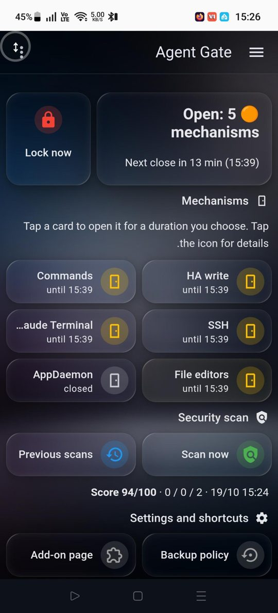
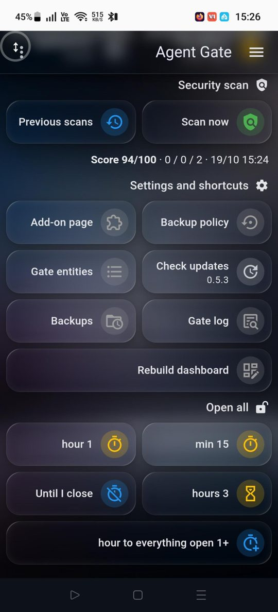

# Agent Gate (Home Assistant add-on repository)

**One switch between an AI agent and everything it can use to change your
Home Assistant.** Locked by default; you open a timed window from the
dashboard or your phone. The gate backs up first, hides your secrets from the
agent, asks you before destructive commands, watches for bursts of deletions,
plants decoys that lock everything when touched, and reports on the security
of the whole system.

Full documentation, install steps, options and FAQ:
[agent_gate/README.md](agent_gate/README.md). Release notes:
[agent_gate/CHANGELOG.md](agent_gate/CHANGELOG.md).

## What it looks like

The add-on ships its own dashboard (English or Hebrew, built for phones):
status and lock on top, one card per mechanism, the security scan with its
score, shortcuts, and the "open everything" buttons at the bottom.

  
  &nbsp;&nbsp;
  

*Five mechanisms open on a timed window, score 94/100 after a scan. The same
dashboard is available in Hebrew.*

## Requirements

- Home Assistant OS or Supervised (the add-on talks to the Supervisor; it
  does not run on Container or Core installs).
- The Mosquitto broker add-on (or any MQTT broker HA is connected to).
- [Home Assistant MCP Server](https://github.com/homeassistant-ai/ha-mcp) with
  its Webhook Proxy add-on, if you want the agent's HA writes gated.

## Add this repository to Home Assistant

Click the badge above, or go to Settings → Add-ons → Add-on store → ⋮ →
Repositories and paste:

    https://github.com/yaniv376/ha-agent-gate

Then install **Agent Gate** and follow the install section of the
documentation (set the MCP Server URL, point the Webhook Proxy at the gate,
install the backstop package, turn off start-on-boot for the editing add-ons).

## Works with

- [Home Assistant MCP Server](https://github.com/homeassistant-ai/ha-mcp) and
  its Webhook Proxy add-on (the gate sits between the proxy and the server).
- Any agent that reaches Home Assistant through that path: Claude via the
  Home Assistant connector, or others.
- Editing add-ons you want under control: Advanced SSH & Web Terminal,
  Claude Terminal, Studio Code Server, File editor, AppDaemon, and any other
  add-on slug you list.

## License

MIT, see [LICENSE](LICENSE).

## Contributing

Issues and pull requests are welcome. Everything in this add-on is meant to
work for any Home Assistant setup: defaults are generic, every check in the
scan applies to everyone, and every behaviour is an option.
